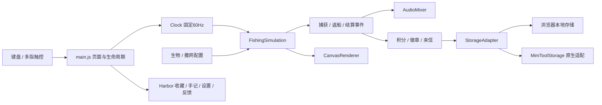

# 架构与开发设计导航

本文描述v0.4.1实际实现；更完整的设计推导见[早期TDD](docs/03_开发设计文档_TDD.md)，冲突处以本文、当前配置和最新实施记录为准。

## 运行结构

静态HTML/CSS + 原生JavaScript + Canvas2D + WebAudio，无服务端和运行时依赖下载。源码为ES模块；esbuild将入口打成经典IIFE，目标ES2017/Chrome61，CSS也转换到Chrome61目标。Node与npm仅在开发和打包时需要。

`main.js`协调页面状态、输入消费、模拟推进、事件音效、HUD与存档；`Harbor.js`生成港湾弹窗及分享/备份交互。海湾及生物绘制在 `src/render`，图鉴入口也由主流程组织。

## 状态与规则

页面有准备、游玩、暂停、结算状态；模拟区分操作阶段、收尾和结束。90秒结束后处理在途网，不把尚未返船的捕获立即算入最终成绩。抛网包含蓄势/挥臂、飞行展网、落水、下沉、收拢、提网返船。具体时长和运动配置见 `src/config/net-motion.js`。

同一时刻最多一张网，按下申请抛出、持续按住控制下沉、松开收拢。输入所有权区分键盘与触点，不能由另一个手指错误释放当前网。六格容量，生物占一或两格，不够容量不捕获。捕获几何与计分依赖模拟数据，绘图与动画不得改变命中结果。

固定60Hz逻辑搭配种子随机数，快照保存模拟所需状态。帧间隔过长时触发过载处理而非无界补帧；后台/取消操作时暂停，恢复后重置时钟。相同版本、种子及输入支持确定性复现，跨版本遭遇规则变化不承诺完全相同。

## 数据与成长

| 文件 | 责任 |
| --- | --- |
| `src/config/creatures.js` | 20种可捕、生物ID/分值/容量/水层、海域组合、6类观赏 |
| `src/systems/collision.js` | 连续运动下捕获几何 |
| `src/systems/scoring.js` | 基础分与按只数计算的同网倍率 |
| `src/config/badges.js`、`src/systems/Progress.js` | 52枚徽章、三类来信、成长归一化和旧图鉴回填 |
| `src/config/badge-art.js`、`src/render/BadgeArt.js` | 首批32枚图集映射、新增20枚程序徽章、佩戴展示 |

徽章装饰不改变积分或概率。单次出海使用runId做重复结算防护；历史保留最近60局。旧图鉴缺失新物种时补零，章鱼/龙虾等初见按已有收藏回填。历史成绩不因新分值或新规则重新计算。

## 存档与平台边界

`StorageAdapter`使用 `castfishing-profile-v1` 和 `castfishing-checkpoint-v1`，schemaVersion为1。档案包含纪录、收藏、成长、设置、战绩与已结算ID；checkpoint包含模拟快照。自动存档周期5秒，并支持手动保存和恢复。

浏览器构建直接适配异常保护的localStorage。容器构建在9.46+且方法齐全时，先通过 `MiniToolStorage`读入原生数据，再启动页面；缓存提供同步接口，异步写入串行排队。首次迁移优先checkpoint、后profile，保留原浏览器数据。原生读取失败禁止覆盖；结算等待flush，写失败保留checkpoint并可重试。原生SDK单元测试为模拟，不等于真实客户端验收。

备份为 `glasswater-backup-v1`。浏览器可JSON文件导出/选择恢复，容器改用textarea生成和粘贴预检查，明确替换后应用。原生多key恢复没有跨key事务保证；需依靠错误提示和保留备份文本处理失败。

| 能力 | 浏览器构建 | 容器构建 |
| --- | --- | --- |
| 备份 | 本地JSON文件 | 可选中文本/粘贴 |
| 保存成绩卡 | 浏览器下载 | `saveImageToPhotosAlbum`能力检测 |
| 分享 | Web Share或降级 | `postNote`，必要时`writeTempFile` |
| 反馈 | 整理草稿、可用时复制 | 整理并选中文本，玩家手动复制 |

`__MINITOOL__`编译开关裁掉容器不允许的浏览器分支。用户主动点击才调用平台能力，没有自动发笔记或上报。

## 视觉、音频与兼容

场景JPG、两张徽章WebP及SVG图标打入离线包；生物/渔民/网和额外徽章由Canvas绘制。WebAudio合成配乐、音效和环境声，三个设置独立，默认关闭，用户手势解锁。

`Compatibility.js`为replaceChildren提供局部回退，实际检测Flex gap并添加margin回退类；CSS提供Grid间距、安全区、尺寸和颜色基线。构建目标不代表Chrome61实际性能通过；Pointer Events、iOS长按和原生SDK仍需对应设备检查。

## 测试与交付

`tests/*.test.js`覆盖模拟、成长、输入、徽章和原生存储适配；`npm run package`验证浏览器资源，`npm run package:minitool`检查结构、引用、禁用API、经典语法、体积和ZIP字节回读。官方审计作为独立门禁。完整步骤见[发布流程](docs/release/RELEASING.md)。
