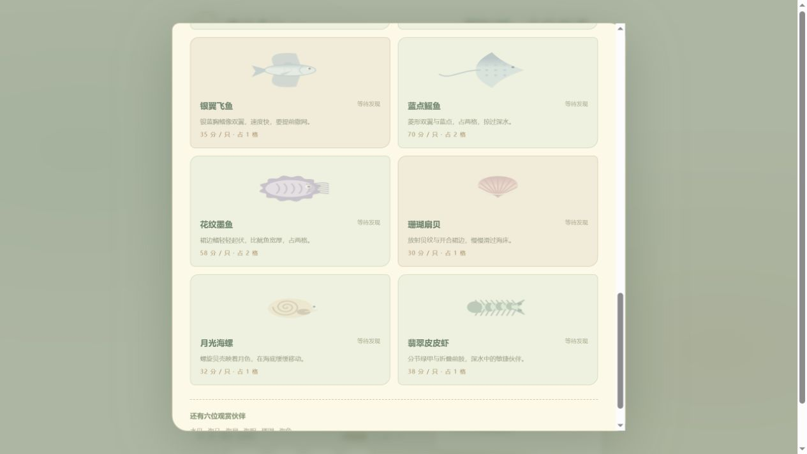
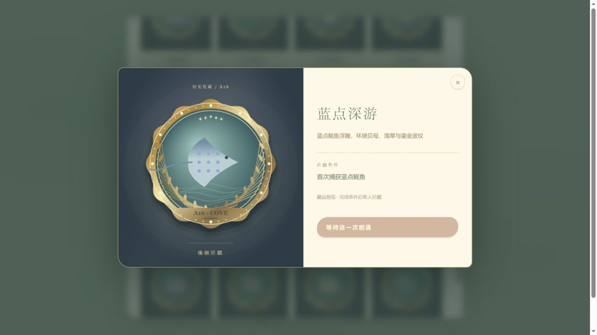

# 琉璃海湾 · Glasswater Cove

驾驶小渔船，观察水层与鱼群，等待一张好网。

轻休闲离线 Canvas H5 捕鱼小游戏，支持普通浏览器和小红书小工具两种构建。**90 秒出海、一次一张网、20 种可捕生物、52 枚收藏徽章**，没有后端或运行时网络依赖。

[快速开始](#快速开始) · [下载 v0.4.1](https://github.com/zhuxian518/glasswater-cove/releases/tag/v0.4.1) · [文档索引](docs/README.md) · [更新日志](CHANGELOG.md) · [开发指南](CONTRIBUTING.md)

## 当前版本

**v0.4.1 · 可玩预览版**。玩法、画面、声音、存档和容器适配已实现；平台模拟器、Android / iOS 扫码及真实 SDK 仍待验收，GitHub Release 标记为预发布。没有已通过小红书审核或全机型验证的声明。

<p align="center"> </p>
<p align="center"><em>实际浏览器截图；图鉴、徽章预览不代表已解锁全部内容。</em></p>

| 体验 | 当前内容 |
| --- | --- |
| 撒网过程 | 渔民蓄势、挥臂、空中展网、落水、下沉、兜鱼、提网返船后计分 |
| 判断与取舍 | 按住沉网，松手收拢；六格容量，小生物一格、大生物两格；一网回船才能再抛 |
| 海底生态 | 20种可捕生物，涵盖鱼、虾蟹、头足类和贝螺；6类观赏生物 |
| 出海变化 | 三种海域遭遇组合、水层差异和末段稀有机会；不保证每局出现全部物种 |
| 得分与收藏 | 基础分、同网数量加成、单网与单局纪录、图鉴、52枚可佩戴徽章 |
| 持续目标 | 三类跨局来信、最近60局出海手记、成绩卡 |
| 视觉与声音 | 手绘海湾背景、程序生物动画、珐琅徽章、原创合成配乐与音效，独立开关 |
| 记录与交流 | 手动/自动存档、备份恢复、主动分享与反馈草稿，按平台能力降级 |

已实现数量以配置和[当前产品规格](docs/CURRENT_PRODUCT.md)为准。早期PRD、美术稿和120枚徽章内容库保留为设计背景，不能当作完成清单。

## 快速开始

开发需要 **Node.js 22+、npm、Git**。

```sh
git clone https://github.com/zhuxian518/glasswater-cove.git
cd glasswater-cove
npm ci
npm run build
npm run dev
```

访问 <http://127.0.0.1:4188/>。预览服务读取 `dist/`，修改源码后需要重新构建，不提供自动热更新。

| 操作 | 手机/平板 | 电脑 |
| --- | --- | --- |
| 移动渔船 | 按住左右按钮 | 方向键或 A / D |
| 下网 | 按住撒网按钮 | 按住空格 |
| 兜鱼并收网 | 松开撒网按钮 | 松开空格 |
| 暂停 | 点击暂停按钮 | 点击暂停按钮 |

先观察鱼群方向，在鱼群前方下网，再按水层决定松手时机。空网和少量捕获都是可能结果；徽章不提高捕获概率。

### 手机同 Wi-Fi 试玩

先完成 `npm run build`，在PowerShell中运行：

```powershell
$env:HOST = '0.0.0.0'
$env:PORT = '4189'
npm run dev
```

电脑和手机连接同一Wi-Fi，手机打开 `http://电脑的Wi-Fi IPv4地址:4189/`。电脑与服务需保持运行，并允许该端口通过本机防火墙。`0.0.0.0` 是监听地址，不能作为手机访问地址；`127.0.0.1` 只指访问设备自己。

## 验证和打包

```sh
npm test
npm run package
npm run package:minitool
```

| 输出 | 用途 |
| --- | --- |
| `dist/`、`琉璃海湾-v0.4.1.zip` | 普通浏览器离线试玩，解压后打开 `index.html` |
| `dist-minitool/`、`琉璃海湾-v0.4.1-小红书上传包.zip` | 小红书容器专用构建，裁掉受限浏览器能力 |
| `docs/release/minitool-v0.4.1-audit.json` | 容器包文件、体积、哈希和检查范围 |

源码分支不保存依赖或构建目录。直接下载的ZIP、文档包与SHA-256校验文件见 [Releases](https://github.com/zhuxian518/glasswater-cove/releases)。两个游戏ZIP用途不同，请勿互换。ZIP时间戳可能使重新打包的整包哈希不同，冻结附件以Release校验值为准。

本地49项自动测试覆盖模拟、计分、单网、容量、图鉴、成长、旧存档兼容和模拟SDK存储。容器包于2026-10-12按用户指定的官方 `minitool-zip-builder` 1.7.0 检查，目录和ZIP均通过。2026-10-20仓库归档验证见[发布记录](docs/release/v0.4.1.md)。上传前仍需核对当时上传页规范，完成平台模拟器及Android/iOS真机扫码验证。

## 工程和文档

```text
src/core/       固定步长模拟、随机数、时钟
src/systems/    碰撞、积分、徽章和来信
src/config/     生物、徽章与撒网参数
src/render/     海湾、生物、渔民、网和徽章绘制
src/input/      键盘、多指触控和取消处理
src/audio/      合成配乐、音效和环境声
src/platform/   本地/原生存储与兼容处理
src/ui/         港湾、设置、手记等界面
public/assets/  运行素材及保留的场景原稿
tests/          Node自动测试
scripts/        构建、静态检查、打包、预览和诊断
docs/           产品、架构、美术、研究、实施和发布记录
.github/        Issue与PR模板
```

| 文档 | 内容 |
| --- | --- |
| [当前产品规格](docs/CURRENT_PRODUCT.md) | 当前规则、积分、生物、徽章、功能及边界 |
| [架构说明](ARCHITECTURE.md) | 模块、状态、数据流、构建和存储 |
| [详细PRD](docs/02_产品需求文档_PRD.md) / [开发设计](docs/03_开发设计文档_TDD.md) | 早期完整策划和技术方案，与当前规格配合阅读 |
| [完整文档索引](docs/README.md) | 研究、设计、实施记录和版本优先级 |
| [开发指南](CONTRIBUTING.md) / [维护规则](AGENTS.md) | 环境、修改入口、测试、提交约定 |
| [发布流程](docs/release/RELEASING.md) / [v0.4.1记录](docs/release/v0.4.1.md) | 两种构建、校验、归档与待测项 |
| [素材登记](docs/assets-register.md) / [第三方声明](THIRD_PARTY_NOTICES.md) | 生成素材、程序绘制、依赖和官方工具 |
| [安全与数据说明](SECURITY.md) | 本机存储、主动分享、问题报告 |

## 维护与授权

仓库公开用于展示和查阅。**公开可见不代表授予开源许可**；项目目前保留权利，详见 [LICENSE](LICENSE)。第三方依赖遵循各自许可。需要复制分发、商业使用或复用素材，请向仓库所有者 `zhuxian518` 询问。

普通问题和建议可通过 [Issues](https://github.com/zhuxian518/glasswater-cove/issues) 提交。当前未启用GitHub Actions，工作流以示例保存在发布文档目录，不显示未经执行的CI徽章。
