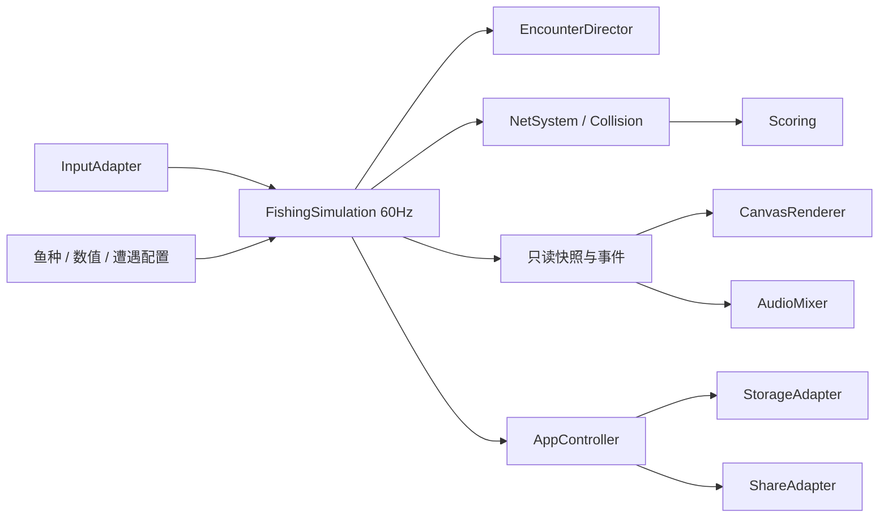
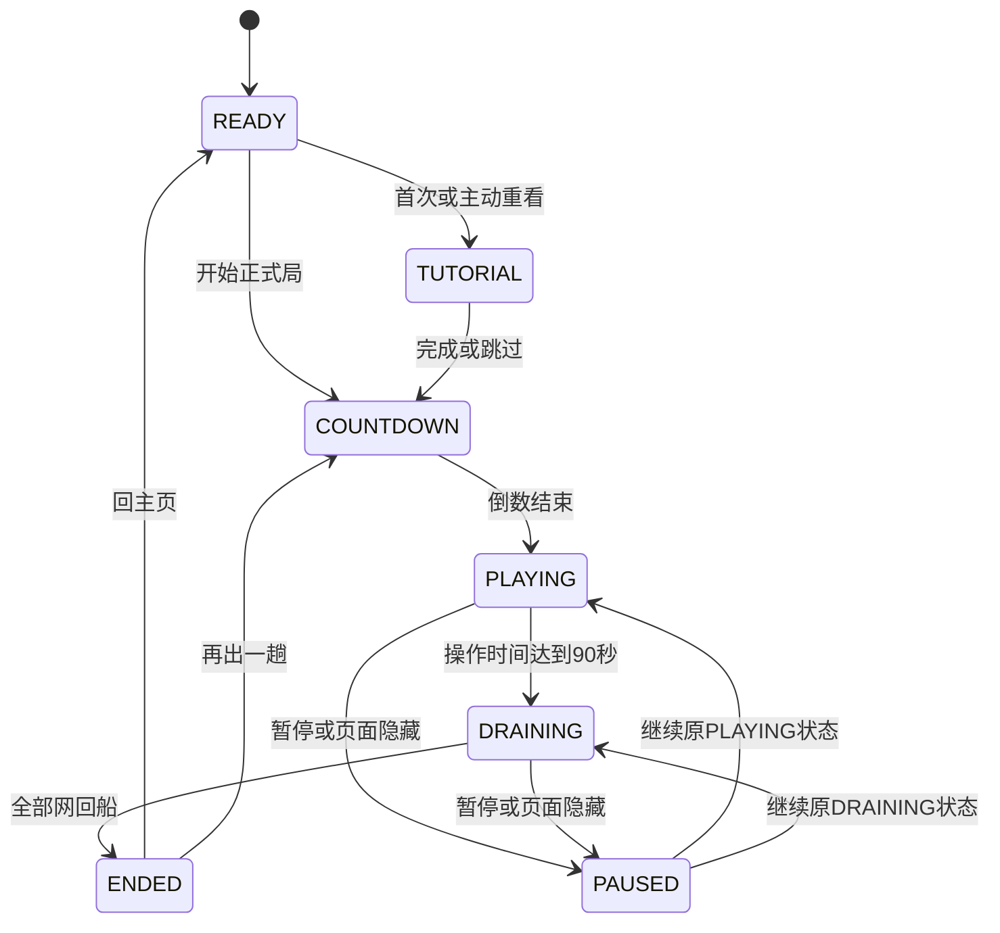
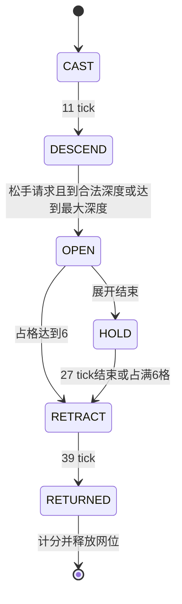

# 撒网打鱼｜开发设计文档 TDD

> 实施进度：首个可玩版本v0.1.0已开发；本文保留v0.4设计基线，已实现和待验收项目见[07号记录](07_首版实现与验证记录.md)。

版本v0.4；2026-10-12；状态：设计，未实现。产品规则以[PRD](02_产品需求文档_PRD.md)与[生物及撒网机制](06_生物多样性与撒网机制.md)为准，视觉制作以[美术与动效规格](05_美术与动效设计规格.md)为准。本文给出可实现的契约与验证方法，不把旧作测试结果视为新游戏已通过。

## 1. 架构结论

沿用原生 JavaScript、Canvas 2D、固定 60Hz 模拟与独立平台适配层，继续使用 esbuild 输出经典 IIFE。不引入游戏引擎、后端、实时网络、物理绳索或复杂群集 AI。

建议从《深海较量》的已记录基线复制必要源码到本项目，形成独立产品，不在稳定旧作里切换主题。保留来源与改动清单；首次实现前再次记录旧作 HEAD 和工作区状态。当前审阅基线为 `c689da06c7f576904e64a2b31e34eff6bf655a84`，工作区干净。

### 1.1 模块复用矩阵

| 旧模块 | 处理 | 原因/新契约 |
|---|---|---|
| `src/core/Clock.js` | 复用并补过载处理 | 固定步长与渲染插值；不能静默丢时间导致局长漂移 |
| `src/core/Random.js` | 复用算法、拆随机流 | 出生计划与表现随机分开，策略对比公平 |
| `src/input/InputAdapter.js` | 复用多指/键盘基础 | 改为有序按下/松手命令、单网控制绑定、禁止长按连发 |
| `src/systems/Collision.js` | 复用基础几何，新增圆形连续碰撞 | 快鱼与张网过程需要稳定捕获仲裁 |
| `src/core/Simulation.js` | 改为 `FishingSimulation`，保留骨架 | 移除鱼雷/生命/连爆/补给/波次终止；新增网状态与短局导演 |
| `src/systems/Scoring.js` | 重写 | 单网到船计分，无连锁深度和效率奖励 |
| `src/core/Checkpoint.js` | 新 schema 与校验 | 保存网生命周期、鱼归属、出生游标、待结算鱼获 |
| `src/systems/Progress.js` | 改写 | 10种捕获图鉴与观赏生物说明、本机 20 局、单网纪录与幂等结算 |
| `src/render/CanvasRenderer.js` | 重做主题与事件表现 | 保留 resize/限特效/只读接口，重画船、鱼、网、成绩卡 |
| `src/audio/AudioMixer.js` | 复用手势解锁与中断恢复 | 替换全部战斗音色与音乐；保留声部限额 |
| `src/platform/StorageAdapter.js` | 参数化 key/schema 后复用 | 禁止与旧游戏共用数据；使用当前平台契约 |
| `src/platform/ShareAdapter.js` | 复用调用结构，改媒体与文案 | 保存与分享用户主动触发，结果状态如实反馈 |
| `src/app/AppController.js` | 复用生命周期，改页面流程 | 新增 DRAINING，移除波间战报与通关分支 |
| 构建/审计/打包脚本 | 复用结构并更新产物身份 | 新名称、新资源清单、零外部依赖、独立候选包 |
| 旧测试 | 按适用行为迁移 | 不机械保留军事数值和连爆断言；新捕获规则须新增测试 |

“可复用”指实现结构或基础设施，**不提供未经测量的代码复用百分比**。改动最大的两块是捕鱼模拟和全套视觉反馈。

### 1.2 目标目录

```text
src/
  app/AppController.js
  core/{Clock,Random,FishingSimulation,Checkpoint}.js
  systems/{EncounterDirector,NetSystem,Scoring,Progress}.js
  input/InputAdapter.js
  render/{CanvasRenderer,CreatureShapes,NetPainter,ScoreCard}.js
  audio/AudioMixer.js
  platform/{StorageAdapter,ShareAdapter}.js
  config/{game-balance,creatures,encounters}.json
  css/main.css
  main.js
public/assets/                 # 精修场景、船鱼部件、共享特效图集与本地声音
tests/                         # 纯逻辑、浏览器、适配契约
scripts/                       # 构建、审计、打包、体验诊断
dist/                          # 正式离线静态产物
```

这是目标结构，当前交付只有设计文档，不应误认为这些实现文件已经存在。



依赖约束：模拟层不能访问 DOM、平台 SDK、真实时间或音频；渲染/音频不能修改鱼的位置、网状态和分数。App 管理页面、暂停、输入启停和持久化。

## 2. 运行状态与时钟

### 2.1 局状态



实现上 `PAUSED` 为 App 对模拟的冻结层，保留 `resumePhase`，避免复制一套模拟实体。READY/COUNTDOWN/教程时间不消耗正式操作时间。

- `playTick`：只在 PLAYING 推进，范围 0…5400，5400/60=90 秒。
- `tick`：PLAYING 和 DRAINING 的模拟总 tick，用于稳定事件时间。
- 开始某步前若 `playTick===5400`，先进入 DRAINING，再处理输入；不多发一网。
- DRAINING 不出生鱼、不接受移动和撒网；既有自由鱼及网继续模拟。
- 显示秒数 `ceil((5400-playTick)/60)`；0 时显示收网文案。
- 结束条件为网数组为空，不依赖“鱼是否全部离屏”。

60Hz 是逻辑频率，**不是对所有真机渲染 60 FPS 的承诺**。渲染 30 FPS 时可每帧做两步模拟，保持规则与局长。

### 2.2 卡顿与后台

沿用 accumulator 与插值，单次渲染最多补五步。若补五步后仍欠至少一步，不静默清空累计时间：记录过载、自动暂停并提示低特效后继续，恢复重置帧时间基线。暂停期间不补算。90 秒定义为有效模拟操作时间；正常负载约等于 90 秒现实操作，严重卡顿会暂停，不能伪称所有设备严格同速。

`visibilitychange`、`pagehide`、失焦时释放输入、冻结逻辑、停止音乐并尽力保存。异步保存不延迟暂停；恢复音频需要可用的用户手势，不强行自动播放。

参考：[固定时间步与过载风险](https://gafferongames.com/post/fix_your_timestep/)、[requestAnimationFrame 与后台行为](https://developer.mozilla.org/en-US/docs/Web/API/Window/requestAnimationFrame)。本项目据此制定具体暂停策略。

## 3. 数据模型

### 3.1 核心运行实体

| 实体 | 主要字段 | 约束 |
|---|---|---|
| Run | `runId, mode, seed, balanceVersion, tick, playTick, phase, nextEntityId, eventId` | mode 为 formal/tutorial/practice；所有 ID 单调递增 |
| Boat | `x,y,px,py,speed,cooldownTicks` | y 固定在水线；x 钳位到船半宽内 |
| SeaCreature | `id,typeId,schoolId,x,y,px,py,vx,halfW,halfH,status,ownerNetId,sizeCost` | 10种可捕统一实体；status=FREE/CAPTURED；捕获后不参与其他网碰撞 |
| School | `id,template,direction,creatureIds` | 编队只用于出生与诊断，不能整体结算 |
| Net | `id,phase,phaseTime,x,y,px,py,originX,openRequested,radius,captured,usedSlots,returned` | active net≤3；usedSlots≤6；无triggerFishId |
| CatchItem | `creatureId,typeId,baseScore,sizeCost,captureTick,captureTime` | 归属不能重复；分值与占格捕获时快照 |
| NetControl | `controlledNetId,pressArmed,physicalOwnerId` | 最多一个CAST/DESCEND网受控；保存前清除物理owner，逻辑网ID保留 |
| EnvironmentCreature | `id,typeId,visualPhase,depthLayer` | 只表现，活动实例≤6，不进碰撞/计分 |
| RunStats | `casts,completedNets,emptyNets,fullNets,caughtByType,bestNetCount,bestNetSlots,bestNetScore,score` | 到船才计正式鱼获和分数；fullNets按6/6格计 |
| Director | `scheduleSeed,themeId,themeSpecies,nextEncounterIndex,nextRareIndex` | 主题三额外种与出生计划固定于种子，不依赖命中 |

主体半宽/半高初值：F01=26/11、F02=32/12、F03=34/14、F04=38/16、F06=32/14、F09=25/12、F10=32/18、F11=34/15、F12=32/27、F13=38/22。判定用身体而非长须/末端触腕；动作不偷偷改变hitbox。网下沉x固定为抛出x，回收时间不依赖船移动距离。

配置增加kind、sizeCost、allowedDepths、motionProfile、catchable、hitbox；F10/F13只在y=980横向爬行，F12在780/980，完整参数与主题种池见06号文档。捕获ID保持F01/F02/F03/F04/F06/F09/F10/F11/F12/F13，环境ID为E01–E06；这里的前缀是标识，不能把虾蟹解释为鱼类。环境层与捕获数组完全分开。

### 3.2 Profile 与命名空间

新 key：`castfishing-profile-v1`；不得使用旧 key `depthchain-profile-v1`。

```json
{
  "schemaVersion": 1,
  "productId": "castfishing",
  "runSequence": 0,
  "recordVersion": "fishing-v0.4",
  "bestScore": 0,
  "bestNetCount": 0,
  "bestNetScore": 0,
  "archivedRecords": [],
  "tutorialSeen": false,
  "collection": {
    "F01": 0,
    "F02": 0,
    "F03": 0,
    "F04": 0,
    "F06": 0,
    "F09": 0,
    "F10": 0,
    "F11": 0,
    "F12": 0,
    "F13": 0
  },
  "settings": {
    "sfx": true,
    "music": false,
    "lowFx": false
  },
  "history": [],
  "committedRunIds": [],
  "checkpoint": null
}
```

`history` 最多 20 条：runId、版本、seed、score、caught、bestNet、结束时间、mode；`committedRunIds` 最多 60 条。教程不写累计/纪录；练习记录隔离，正式首页不把练习分数当纪录。

`recordVersion` 对应当前计分规则版本。更改计分/容量等影响可比性的规则时，将旧最高分与单网纪录归档到 `archivedRecords`（最多10个版本），当前最高分从新规则下重新统计；图鉴累计可延续。历史成绩保留版本，首页只显示当前规则纪录。

当前局中的新生物标记属于待提交结果，按到船更新运行统计并存进 checkpoint；正式图鉴累计在整局提交时更新，避免重载旧局反复增加累计数。游戏中可展示本局新发现提示，界面需区分“本局发现”与历史累计。

## 4. 配置契约与校验

配置拆为世界/船/网/鱼种/遭遇/计分/视觉预算，禁止同一参数散落多个文件。

| 配置 | 初值 | 校验 |
|---|---:|---|
| world | 1000×1200；waterline=155 | 有限正数，水线在世界内 |
| durationTicks | 5400 | 正整数 |
| boatSpeed | 440 | >0；船不能超边界 |
| maxNets / capacitySlots | 3 / 6 | 最多一个受控网；sizeCost为1或2，累计占格≤6 |
| castTicks | 11，约 0.183 秒 | 正整数 |
| cooldownTicks | 27，0.45 秒 | 正整数 |
| sinkSpeed / minOpenDepth / maxDepth | 360 / 320 / 1030 | 水线<最小展开深度<最大深度；最大深度留出网半径空间 |
| openTicks / holdTicks / retractTicks | 15 / 27 / 39 | 正整数 |
| startRadius / openRadius | 12 / 95 | 仅OPEN/HOLD有效；下沉12半径只作视觉 |
| maxFreeCreatures / maxEnvironmentActive | 32 / 6 | 普通可捕最多30、稀有预留2；环境独立 |
| historyLimit / checkpointBytes | 20 / 64KiB | 超限拒绝存档而非扩大实体上限 |

PRD 的 0.18 秒是表达近似；实现以 11 tick 为准。最深网的最长生命周期上界为 `11 + ceil((1030-155)/360*60) + 15 + 27 + 39 = 238 tick`，约 3.967 秒。满网可更早收回。

`validateConfig` 需要按字段验证，不能沿用旧作“所有 number 必须 >0”的泛化遍历；本产品允许部分权重为0、计数为0、方向为负数。所有概率和权重必须有限，权重归一化且类型存在；坐标与模板边界校验独立。

计分用有理数倍率 `[100,110,125,150]/100`，`floor(sumBase*multiplierInt/100)`，避免多次浮点取整。所有整数上限应在安全整数范围内。

## 5. 出生导演与变化

### 5.1 随机性边界

局开始时从 `seed` 派生 `scheduleSeed`，预生成 90 秒遭遇列表。出生、群形、方向、鱼种、速度系数、稀有鱼计划只使用该流；捕获不抽随机数。表现粒子使用独立随机流，不能推进出生 RNG。

相同seed的固定浅网、固定深网和观察策略面对相同主题及出生计划。实体上限导致的跳过仍可能随清场变化，需单独统计，不能把计划相同写成实际出场数必相同。主题种池与三段权重按06号文档；每局普通7种加稀有1种，前三局覆盖三个主题组合；不是同时刷新10种。

### 5.2 群形模板

| 模板 | 建议布局 | 可玩性 |
|---|---|---|
| compact | 2–6 条，2行×最多3列，中心间距约60×50 | 半径95有机会包住多条，但过早只捕前排 |
| scattered | 2–5 条，x间距110–170，y间距30–70 | 需要接受部分收获，不能保证全收 |
| single/pair | 1–2 条，独立进入 | 选择高价值目标与网位取舍 |
| crossing | 两个已有普通群错开进场，反向、相邻深度 | 形成短时聚拢窗口；不额外突破密度上限 |

crossing 是正常遭遇对的排布，不在三类比例之外无限加鱼。第二、三段每段预排 1–2 次，挤占对应两次普通遭遇。普通速度用鱼种速度×阶段系数×种子决定的 0.90–1.10 微调；第一段阶段系数0.85，其余1.0。鱼群内部速度一致，不突然变速。

首个正式群在 t=0 出现在视野中段浅层，后续从左右边缘外进入。其位置固定于世界布局，不根据船的位置吸附。每15秒片段预留一次浅层 F01/F02 群机会，复用正常遭遇槽位，不额外叠加。

方向、群间隔、深度和鱼种在出生前确定；不按分数偷偷加速，不按空网次数偷偷送中。难度差异主要由 PRD 的三段配置产生。

### 5.3 密度与移除

每次生成前计算剩余普通名额；不足容纳完整群则跳过，不半途随机拆群。稀有计划固定两次、两个预留槽保证机会。已捕鱼从自由鱼列表移出，保存在网的 CatchItem 中；渲染重建轻量网内形象，不能保留成第二份可碰撞实体。

自由鱼离开 `[-maxHalfW, worldWidth+maxHalfW]` 后移除，计为 escaped 诊断，不扣分。尾摆和气泡只表现；如以后加入纵向游动，必须把实际位置纳入模拟与回放。

## 6. 网系统与碰撞仲裁

### 6.1 状态机



CAST/DESCEND均不捕鱼，不能碰到浅鱼就自动张开。松手设置openRequested；若尚未到y=320，继续下沉至320再OPEN；否则在松手步骤的当前位置OPEN。到1030自动OPEN。进入OPEN清除controlledNetId；OPEN/HOLD中心不动，无触发鱼保底。RETRACT不能捕沿途目标，绳索没有碰撞。DRAINING对受控网发出张网请求，不等待被禁用的输入。

### 6.2 连续碰撞

复用旧 `sweptHit` 做粗筛，不能直接把“圆半径扩展成方盒”当最终捕获，避免网角外的鱼被吸走。新增 `sweptCircleBoxTOI`，输入本段网中心、半径起止值、鱼矩形起止坐标，返回 `[0,1]` 的首次相交时间或 null。

推荐实现：相对运动转换到生物固定AABB；按相对轨迹穿越x/y边界时刻分段。每段最近点区域固定，距离平方为二次式，OPEN半径线性增长；解`distanceSquared(t) <= radius(t)^2`的最早有效根并限制在段内。处理初始重叠、零速度、判别式近零和边界切触，统一epsilon。仅OPEN/HOLD参与捕获；HOLD固定95。几何命中后再按sizeCost检查剩余空间，不足时保持自由状态。公式与边界测试一起实现。

视觉网边缘与这套有效范围共用 `radius`。鱼用主体包围盒，不把尾鳍水纹纳入判定；命中范围可在开发模式显示，正式构建移除。

### 6.3 同帧多网的稳定事件处理

1. 本 tick 开始按计划出生、采样输入并更新船，保留所有实体前坐标。
2. 为自由鱼与网建立本 tick 内的线性轨迹和状态时间段。
3. 处理有序输入命令，计算最小/最大深度、张网请求、OPEN/HOLD捕获、阶段结束与回船候选事件。
4. 按 `(tick内时间, eventPriority, netId, creatureId)` 排序；优先级固定并写入测试。
5. 弹出事件时复查目标FREE、网仍可捕、sizeCost≤capacitySlots-usedSlots。无效候选跳过，不偷走已归属目标。
6. DESCEND满足张网条件后切OPEN，为本tick剩余时间计算候选；下沉穿过的目标不能追溯补捕。
7. 捕获立即设置ownerNetId，加入CatchItem并增加usedSlots；占格为6时转RETRACT，后续候选失效。
8. 回船事件调用一次 `settleNet`，标记 RETURNED，释放网位。
9. 清理已移除实体、生成有界事件列表；DRAINING 中无网时结束局。

同刻约定：先确定OPEN边界，再按netId/creatureId仲裁捕获；容量逐条更新，空间不足的候选不占格。OPEN/HOLD区间左闭右开，结束时刻不额外捕获。剩1格不直接提前收回，仍可捕到1格目标。排序不能按分值替玩家挑选，数组遍历顺序不能改变结果。

### 6.4 系统不变量

- activeNets≤3、controlledNet≤1、sum(sizeCost per net)≤6、capturedCount≤6、freeCreatures≤32、activeEnvironment≤6。
- 每个 creatureId 最多一个 ownerNetId、最多一条 CatchItem。
- 已回船的网不能再结算；RETRACT 不新增捕获。
- 运行分数等于所有已回船网分数之和。
- 正式鱼获总条数等于已回船 CatchItem 数量；空网计入 completedNets。
- DRAINING 不增加 casts 或计划新出生数。
- 任何渲染/音频失败不改变上述状态。

## 7. 输入契约

新操作依赖按下/松手顺序；只有held状态会丢失tick之间的轻点。使用有序命令队列：

```text
consumeCommands() -> { moveAxis: -1|0|1, commands: [{seq,type,ownerId}] }
type = CAST_DOWN | CAST_UP | CONTROL_CANCEL
```

命令由输入事件按seq排序，在下一模拟步消费；同tick快速DOWN/UP仍先创建网再记录openRequested。CAST_DOWN在已有controlledNetId时绑定/接管原网，否则仅当pressArmed、冷却结束且有槽才创建。每次有效按下后取消pressArmed，实际UP后重新允许按下；到底自动张网不会自行重新武装或连发。满槽/冷却期间的按下不排队到未来自动投出。多个指针在撒网按钮上只有首个owner有效，其他手指仍可移动船。

CAST_UP仅作用于绑定owner对应的受控网。手指普通滑出按UP处理；系统取消、失焦/后台生成CONTROL_CANCEL，先暂停再清物理绑定，不生成张网请求。恢复保留受控网，首次DOWN接管、UP张开，未接管时下沉到底兜底。只有模拟消费命令；按钮高亮/绘制使用peek，不能抢先吃掉点击。输入物理owner不持久化，逻辑controlledNetId/openRequested要存档。正常UP随后触发的lostpointercapture应去重；只有仍有活动owner时的意外捕获丢失才按CONTROL_CANCEL处理，避免每次正常松手都暂停。

优先 PointerEvent 与捕获，缺失时采用 TouchEvent；沿用窗口级 up/cancel/lostcapture、blur、pagehide 清理。`touch-action:none`、禁止选择与长按菜单只施加在操作区；普通文档/设置不全页锁滚动。移动端双指测试要覆盖任意松指顺序与手指滑出按钮。

参考：[MDN Pointer events](https://developer.mozilla.org/en-US/docs/Web/API/Pointer_events)。不能因为现代浏览器支持就删除最低兼容层。

## 8. 计分、进度与幂等

`settleNet` 用捕获时快照的 baseScore 与条数倍率得分，产生 `netReturned` 事件；空网产生0分事件，仍释放网位。到船前 score 不变。整局结束产生 `runEnded(runId,result)`。

倍率中的条数应统一实现为实际捕获个数，涵盖鱼、虾、蟹与头足类，不使用占格数量。满载水花/fullNets独立依据usedSlots===6，不能复用count>=5判断。统计最佳单网个数与占格两个字段，避免新大体型内容让结算含义漂移。

App 提交正式进度：

1. 若 runId 已在 committedRunIds 中，只展示结果，不重复累加图鉴与历史。
2. 在内存中构造完整新 Profile：纪录 max、collection+=本局到船数、追加历史、追加 runId、checkpoint=null。
3. 一次写入同一 Profile key，保存操作串行，禁止多个异步快照乱序覆盖。
4. 写入成功后确认本地持久结果；失败保留内存结果并允许重试，文案“这次纪录还没存好”。

单 key 快照降低跨 key 一致性需求，不假设平台未声明的事务保证。被强杀发生在保存前时，恢复旧快照；再次完成同一 run 只相对旧 Profile 提交一次，不同时保存“已加图鉴但未清 checkpoint”的分裂状态。

## 9. 存档恢复与版本管理

### 9.1 保存内容

每五秒、暂停、主动保存返回及页面隐藏时保存：runId/mode/版本、两个时间计数、主题种池、RNG/出生计划种子与游标、controlledNetId/openRequested/usedSlots、nextEntityId、boat、自由鱼、活跃网及捕获清单、RunStats、本局目标、eventId。不保存粒子、声音节点、DOM、平台临时文件路径。

### 9.2 恢复校验

- productId、schemaVersion、balanceVersion 匹配；不尝试自动读取潜艇存档。
- 字段有限、有界；时间非负且 PLAYING≤5400；DRAINING 有合理尾收上界。
- 实体 ID 唯一且小于 nextEntityId；已捕鱼 ID 不在自由列表；网引用完整。
- 网状态、phaseTime、openRequested、半径、sizeCost与usedSlots一致；controlledNetId最多指向一个CAST/DESCEND网；计分与统计可对账。
- 出生游标与种子相符；局目标 ID 在配置内；模式合法。
- 存档文本≤64KiB，Profile≤128KiB；超限视为异常，不能直接大量反序列化到实体。

恢复时清空表现事件与物理输入，保留受控网ID与待张网标记，重建集合索引，进入暂停页。继续后首次按下接管原网，松手张开；无按下时继续下沉到底兜底。没有受控网时将pressArmed置true，避免后台遗漏UP造成新投网被永久锁住。已经 RETURNED 的网不再生成回船事件；未完成的网从原阶段继续。

同 schema 兼容的小版本只补缺省字段；改变半径、容量、时长或计分即更新 balanceVersion。无法兼容当前局时保留历史纪录/图鉴、放弃 checkpoint 并清晰提示重新出发。旧版本历史展示版本标签，不把不同规则的成绩强行视为严格可比。

## 10. 渲染、资源与音频

### 10.1 Canvas 分层

背景可预绘制在普通离屏 canvas，非依赖 OffscreenCanvas；每帧合成。活动层绘制船/鱼/网/水花；HUD 和按钮使用 DOM，便于文字与触控。绘制顺序固定：背景→自由鱼→网及网内鱼→绳索→船→有限标签。

视觉升级后，背景拆为远岸/水色/缓存焦散/柔光束/海底层，鱼与船使用精修分件。`WaterPainter`负责有界光影与涟漪，`CreatureAnimator`只做鳍尾姿态与高光，`NetPainter`负责网片/绳索/网兜形变，`FxPool`管理水滴和亮点。网口有效外圈读取模拟半径，内部网片才使用表现缓动；自由鱼主体仍使用统一世界坐标。背景小幅视差不施加到实体位置。高档光效不是核心初始化依赖，资源失败时保留清楚的主体与完整可玩流程。

世界坐标通过统一矩阵等比变换，视觉插值只读 px/py。背景水草不参与判定；鱼尾动画不能移动主体判定中心。成绩卡使用独立 Canvas，只在结算主动生成一次，不能每帧导出。

参考：[MDN Canvas 优化](https://developer.mozilla.org/en-US/docs/Web/API/Canvas_API/Tutorial/Optimizing_canvas)。缓存、分层和实际画布尺寸属于实现建议，最终仍以真机数据判断。

### 10.2 本项目性能预算

| 项目 | 初始预算 | 说明 |
|---|---|---|
| 自由鱼/网/网内鱼 | 32 / 3 / 18 | 网内鱼仅简化表现对象 |
| 粒子/标签 | 标准100、精致160、低档40 / 3 | 超限复用或丢弃表现，不丢规则事件 |
| Canvas DPR | 标准≤1.5，实测允许的精致档≤2，低档1 | 三档drawing buffer均≤200万像素 |
| 音效声部 | ≤6 | 同网入鱼音效合并，避免刺耳叠加 |
| ZIP | 目标≤2MiB | 本地官方 Skill 1.7.0 包内快照上限10MiB；实施时复核 |
| 图片 | 精修分层资源，按展示尺寸与图集组织；解码驻留初定≤32MiB | 一张1024² RGBA解码约4MiB；该预算不等于App总内存 |
| 本机 Profile | ≤128KiB | 明显低于当前在线文档单key1MB限制 |
| 渲染 | 真机目标稳定≥30FPS，较好设备争取60FPS | 目标，未实测 |

持续低帧率先降 DPR/粒子/水纹，不减少自由鱼或改变捕获半径；否则不同设备规则不一致。预设性能档通过运行测量选择，不能靠品牌 UA 猜性能。反复开局需检查数组、音频节点、截图对象释放，避免内存线性增长。

### 10.3 资源制作

程序绘制用于规则原型、网格、遮罩、粒子与诊断；正式P0采用精修海湾层、木船与10种可捕主体与6种环境生物，分件动画和共享特效图集。先验收一张静态关键画面与10–15秒实际渲染动态切片，再批量制作；不能用概念图或占位图代替正式视觉。贴图替换不能改变判定。资产登记包含来源、作者、许可、尺寸、压缩与解码体积及使用位置；不使用竞品截图当游戏素材。概念图、过程示意与最终素材分开登记。

### 10.4 音频

复用 AudioContext 手势解锁、suspended/interrupted 恢复和无构造器降级。独立 music/sfx 开关；暂停与后台停止；返回后只在允许时恢复。声音载入/生成失败不能使 App 启动失败。

参考：[MDN 媒体自动播放](https://developer.mozilla.org/en-US/docs/Web/Media/Guides/Autoplay)。现有 iPad 修复经验是复用依据，不等于新音频已在新游戏测试。

## 11. 小红书平台契约

2026-10-12 已直接读取 [在线容器文档](https://miniapp-sandbox.xiaohongshu.com/minitool/doc)，页面标注最后更新2026-09-22。副本与哈希在调研文档。实施前检查当前契约是否有变化。

- 目标是小工具离线 H5 ZIP，不是小程序、小组件或原生鸿蒙项目。
- 根目录 index.html；脚本、样式、图片、音频全部在包内，资源相对路径；正式脚本经典 IIFE、ES2017/Chrome61 基线。
- 禁用网络请求、外链资源、eval/new Function、WASM、iframe 等受限能力；不加分析 SDK 或远程字体。
- 在线文档当前列出 Android8.1/Chrome61、iOS18.4 最低目标；实际宿主与客户端版本仍需分别验证。
- Storage 需客户端≥9.46.0并存在方法；由 launchOptions/getLaunchOptions 获取 buildVersion，按官方换算规则比较，不做字符串比较。
- 不满足版本条件时可兼容浏览器存储并容忍失败；达到版本条件但原生读写异常时保留内存结果并可重试，不静默启用第二份互相漂移的数据。
- 单key最大1MB、总缓存10MB，data 为 JSON 字符串。首版不需要9.49+文件系统。
- 成绩卡用包内场景/Canvas生成；用户主动保存/分享时按方法能力使用 writeTempFile、saveImageToPhotosAlbum、postNote。临时路径即用即弃。
- postNote 不能被用于强一致的“已公开发布”状态；取消、拒绝、超时、成功分别处理，游戏结果不绑定发布。
- P0不做评论分享，避免引入9.49+的额外契约与恢复路径。

这些约束对应真实交付，不在本轮运行构建/包审计，因为尚未实现游戏。旧包审计结果不能迁移成新包结果。

## 12. 事件与本地诊断

事件携带 `eventId, tick, type, runId`，类型包括 cast、netOpened、creatureCaptured、netRetracting、netReturned、phaseChanged、runEnded。表现消费者按eventId去重；存档恢复不重放历史庆祝。

开发构建额外记录：每网目标附近生物数、松手深度与按住时间、捕获种类/实际个数/占格、空网原因、占位时间、无收获间隔、计划遭遇与跳过数、满网时按钮尝试、帧耗时、规则版本。最多保留当前测试会话，不能无限堆日志。

空网原因只能按观察数据标记“路径无目标/鱼先离开/容量争抢/未触发”等；不声称知道玩家真实意图。试玩访谈再补“玩家想网哪群”。测试导出在开发工具完成，正式包不暴露调试全局对象或访问剪贴板。

## 13. 异常与降级

| 异常 | 处理 |
|---|---|
| 配置错误/未知鱼种 | 启动时拦截，显示可恢复错误页；开发记录具体字段 |
| Canvas2D不可用 | 不进入游戏，显示环境不支持；不白屏 |
| 存储拒绝/坏档 | 内存可玩，保留可解析历史；损坏局不直接恢复 |
| 音频不可用 | 静音继续，不反复弹窗 |
| 分享/相册取消或失败 | 保留卡片，返回结算，不宣称已发布 |
| 重复点击开始/再来/分享 | 单次操作锁，不能启动两个模拟或重复归档 |
| 截图导出失败/资源未就绪 | 允许重试，游戏成绩已独立保存 |
| 页面隐藏、电话中断、系统返回 | 清输入、暂停、尽力保存；恢复需继续操作 |
| 持续过载 | 自动暂停，建议低特效，记录设备与帧数据 |
| 新规则与旧checkpoint不兼容 | 保留累计数据，重新开局，说明原因 |

## 14. 测试与可验证交付

有必要的新增测试聚焦业务不变量，而不是给静态文案/配色写镜像测试：

- 快鱼/切角/初始重叠/半径增长的连续碰撞；同帧双网争抢结果不受数组顺序影响。
- 容量6格、网位3且受控网≤1、满载早收、空网回收、回收不捕沿途鱼、鱼不连锁消失。
- 单网22/56/90/80分示例及混合占格162/206分示例；score与已回船清单对账；重复事件与恢复不重复计分。
- 90秒边界、最后一网、DRAINING暂停恢复、无网立即结束。
- 快速按下/松手命令不丢失、单网接管、轻点最小深度、到底不连发、多指松指顺序、取消只暂停。
- 12可捕/6观赏、主题合法、权重归一、底栖深度与环境不入网。
- 剩一格遇两格目标不占格；满载按占格而非个数；不挤走已捕目标。
- 每个网阶段存档恢复；记录接管/松手命令后，与同seed同命令序列运行一致；取消与松手必须区分。
- 原生存储版本/方法/失败分支、浏览器降级与旧游戏key隔离。
- 同seed策略对照与真实手机三局试玩分开报告。

浏览器测试用于工程诊断；小工具验收需同一候选ZIP的创服模拟器与Android/iOS真机验证。实施、性能测量与体验门槛详见[开发计划与验收](04_开发计划与验收.md)。
