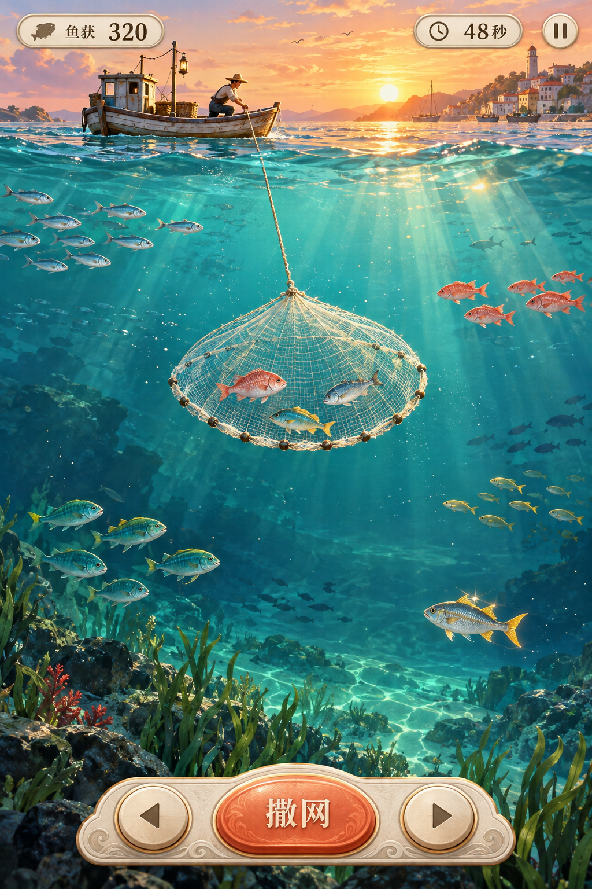

# 撒网打鱼｜美术与动效设计规格

> 实施进度：首个可玩版本v0.1.0已开发；本文保留v0.4设计基线，已实现和待验收项目见[07号记录](07_首版实现与验证记录.md)。

2026-10-12；v0.4；设计稿。用户已明确提高美术、画面与动效投入，要求比《潜艇大战》更精致、更炫酷。本文替代v0.1中以简洁程序绘制为最终画质的默认方案，玩法获得感要求继续适用。

## 1. 视觉定位

推荐方向：**琉璃海湾——通透水体、暖金夕光、精绘小渔船、灵动鱼群与有重量感的撒网动作。**

画面应当让人愿意停留，看鱼穿过光束、看网口逐渐舒展、看鱼在网兜里带着水滴回船。炫酷的重点放在水的质感与收获动作，持续游玩时仍能轻松看清鱼的方向和网的边界。

### 本轮概念图

本图由imagegen于2026-10-12生成，作为色彩、材质、光影与收获氛围参考，分数和鱼获均为演示。图中网的透视形状、大小及远景鱼影需要在实际制作时重排：有效网外圈必须匹配逻辑判定，主鱼群保持小屏可读，装饰鱼影不与可捕目标混淆。它不是动态效果证明或最终UI定稿，也不作为运行时整屏背景。

实现采用精绘贴图、局部分层、Canvas动态光影与变形动画形成2.5D观感。2.5D是视觉描述，不表示改成自由三维场景或承诺真实流体模拟。

### 三条方向的取舍

| 方向 | 视觉特点 | 适配判断 |
|---|---|---|
| 琉璃海湾 | 青绿半透明水体、暖金反光、柔和体积光、细致材质 | 主推荐；适合轻松捕鱼与精致收获 |
| 月色荧光海 | 靛蓝海水、月光、局部荧光鱼/浮游微光 | 可作为后续配色变体；整场需维持轮廓可读 |
| 精绘怀旧渔村 | 手绘纸感、木船纹理、细腻水彩与温暖港湾 | 更生活化；动作仍可精致，炫酷感较含蓄 |

新增生物和按住/松手捕获要求以[06号规格](06_生物多样性与撒网机制.md)为准；本稿同步扩充主体与动作。

本稿以琉璃海湾推进，后两项为可选方向，不为首版同时制作三套资产。主方向尚需概念图与动态样片评审；用户已经确认提高品质投入，不应再把最终画面默认降回几何占位图。

## 2. 画面构成与色彩

### 2.1 分层与质感

| 层级 | 内容 | 精致度要求 |
|---|---|---|
| 远岸/天空 | 暖杏天空、远处港湾剪影、柔云与少量海鸟 | 有空间与生活感，轮廓简化、对比低 |
| 水面 | 薄亮边、慢波纹、碎金反光、船倒影 | 能感到船浮在水上；水面不剧烈遮挡船 |
| 浅水 | 青绿通透、缓慢焦散纹、少量光束 | 鱼鳞亮点和网线清晰，光斑不冒充鱼 |
| 中深水 | 青蓝渐变、分离的远景暗纹、弱悬浮微粒 | 有纵深，深层目标仍可辨识 |
| 海底 | 岩石、少量水草、柔影 | 丰富场景，不能与主捕鱼对象争夺注意力 |
| 交互主体 | 木船、鱼、渔网、绳索、鱼篓、水滴 | 全屏最高完成度，主体形态与材质统一 |
| HUD/操作区 | 奶油白底、深青字、珊瑚按钮、浅浮雕边线 | 精细触感，信息清楚，避免游戏画面被厚边框挤小 |

青绿/深青为主，暖金为光，珊瑚色用于主操作与少量鱼种，米白用于网与信息。光效面积小、强弱有层次，金尾鱼不会把普通鱼全部染成金色。

建议颜色沿用PRD主色并补充：夕光`#FFD6A1`、海面高光`#C8FFF0`、中层青蓝`#348E9A`、深水`#1D566C`。这是初稿色板，最终以手机尺寸概念图与实际贴图校色。

### 2.2 纵深与镜头

仍使用固定侧面剖面，船在上部，主屏面积留给水下鱼群。背景可以随船位置做很小的分层视差：远岸约1–2 CSS px、海底约2–4 CSS px；自由鱼和网的世界位置不随装饰视差偏移。

全程不做大幅镜头推拉或晃屏；满网时局部水花、网兜弹性和轻量前景亮度足以形成高潮。动效不能额外露出可捕鱼域或改变预判距离。

一局保持统一夕光场景，不在90秒内强行经历昼夜。后续昼/夜变体作为独立主题切换，不能靠突变环境亮度干扰鱼群判断。

## 3. 主体美术规格

### 3.1 小渔船

精绘木纹与船舷亮边，船底水线、短倒影、船员抛网姿势、绳卷与鱼篓共同形成识别。船体、船员手臂/网、绳卷和水花分层；船体随水面轻微起伏，转向有不超过约2°的倾斜与回正。

船的真实模拟位置仍固定水线；装饰摇摆幅度控制在约1 CSS px，不能让玩家误判网从哪里下水。船尾水纹对应移动方向，停车后平滑消退。

### 3.2 十种可捕获主体与六种观赏生物

鱼身采用精绘明暗面、局部鳞片/鳍纹、背部高光和柔和腹部反光；在小屏正常尺寸下先读轮廓，再读色彩和纹理。

- 小银鱼：细长、银白侧面，转动尾鳍时有短暂细亮线。
- 青背鱼：青背/浅腹分区，尾鳍幅度清楚，游动轻快。
- 黄鳍鱼：黄色长鳍与修长轮廓，速度感来自尾摆节奏和很短的尾流。
- 红鲷鱼：珊瑚色较高鱼身，鳍与身躯有前后层次。
- 金尾鱼：独特金尾与细闪，进入光束时短暂提亮，常态仍能靠轮廓识别。
- 海虾：长须与尾扇脉动；判定只取躯干，长须不造成错误命中。
- 海蟹：宽甲、双螯与横向蟹腿动作，始终位于可捕底层。
- 龙虾：分节硬壳、长触须与尾扇，和海蟹在轮廓、步态及网内姿势上区分。
- 鱿鱼/章鱼：分别表达梭形快游与圆头多腕慢游，网内触腕动作能看懂。
- 水母/海马/海星/海胆/珊瑚/海龟：采用远层或边缘的低对比观赏表现，区别于目标，不加入误捕惩罚。

可使用鱼身/尾鳍局部分件或少量关键帧实现不同尾摆周期，初值0.45–1.0秒。主体碰撞坐标不因尾摆或高光变化而移动；不使用大幅整体缩放造成鱼忽大忽小。入网后切换为网内小幅摆动，明确已捕获状态。

### 3.3 渔网与绳索

网口有米白沉子边缘、半透明细网格、网片叠层与湿润高光；收拢后成为有鱼形起伏的网兜，不能像一个发光能量球。

外边缘严格匹配当前有效捕获半径；网片内部、尾绳与水滴可做弹性跟随。完全展开阶段保持真实的有效形状，装饰高光位于边缘内，不通过超大光圈假装可以网到更远的鱼。

绳索分段曲线表达松紧：抛出有弧度，下沉逐渐拉直，收回变得紧绷；不需要真实绳索物理。绳索最多三根，重叠时降低非主网绳线的对比，保持鱼群清楚。

## 4. 撒网动作的表现时间表

按住沉网、松手张网、自动回收；下沉阶段不捕鱼。规则时长沿用当前PRD/TDD。视觉动作贴合真实状态，庆祝尾声可以延续在表现层，但不延长网位占用、不冻结鱼群、不追加捕获。

| 动作 | 规则时段 | 视觉设计 | 关键约束 |
|---|---|---|---|
| 抛网 | 11 tick，约0.183秒 | 手臂带动圆网抛出、短弧线、网片扇开、绳尾跟随 | 不在这阶段提前捕获；不增加额外蓄力等待 |
| 入水与下沉 | 按住时间决定，轻点至少到y=320 | 两圈柔涟漪、少量水滴、沉子下压、细气泡尾迹 | 下沉路径与速度可读，不扭曲目标位置 |
| 完全张网 | 松手请求或到底后15 tick，0.25秒 | 外圈准确扩张，内网片略滞后舒展，亮边短暂扫过 | 外圈半径与模拟一致；只内网/绳子使用缓动 |
| 鱼入网 | OPEN/HOLD内实际事件 | 鱼逐条转入网兜，网片局部受力，轻水泡 | 不把整群吸入、不夸大捕获条数；事件立即可读 |
| 网兜收拢 | 回收39 tick的前约0.16秒 | 边缘收紧、鱼体压成有层次的网内群 | 本阶段已停止新增捕获 |
| 提网回船 | 回收剩余约0.49秒 | 紧绳牵引、网兜有重量感、末段减速、滴水与小水花 | 与总0.65秒回收同步；不改变正式计分时点 |
| 到船尾声 | 到船后约0.3–0.5秒，仅表现 | 鱼篓轻弹、合并得分签、涟漪散开 | 网位已释放，下一网正常可用 |

同帧多个网回船时，合并音效和标签，不能叠三个大面积高潮。实际贴图动画与时长应提供可调整参数，不在代码里散落固定数值。

## 5. 收获的视觉等级

| 收获 | 画面强度 | 重点 |
|---|---|---|
| 空网 | 低 | 空网布料收紧、轻水滴；动作仍精致，不弹失败大字 |
| 1–2条 | 中低 | 看见具体鱼、细小网兜摆动、回船明确落点；普通收获也完整 |
| 3–4条 | 中 | 网兜更饱满、水花略多、合并音阶与分数签 |
| 占满6/6格 | 短时较高 | 网口暖亮、鱼兜有重量、提网水滴弧、鱼篓轻弹与短乐句 |
| 新鱼发现 | 独立强调 | 鱼种轮廓与名签短显，图鉴入口小提示；不盖住整片水域 |

视觉丰盛度同时反映真实个数、占格与体积；三只占两格的生物也可满载，不画出不存在的六条鱼。不能空网也放满载水花，不能用持续金币雨覆盖每次普通收获。满网表现的稀缺感与玩法的低频满网目标一致。

## 6. 界面精修

- 标题可做原创字形标记，正文与分数保持清晰；若使用字体文件，须包内授权子集，不引入远程字体。
- HUD使用轻薄半透明感底板、细亮边与清楚字重；文字区域背景稳定，不随焦散明暗闪动。
- 三网位用可辨识的小网图标、阶段进度与回船恢复的短促弹性过渡，触发时准确响应。
- 撒网按钮有按下深度、边缘反光、松手回弹；位移约1–2 CSS px，不缩小命中区域。
- 结算像一张精致的“今日鱼获笺”：鱼获陈列、最好一网、发现的新鱼和柔和纸/木材质。分数跳字≤0.6秒，点击即可跳过展示动画。
- 首次教程、暂停、图鉴沿用同一视觉语言，不在各页分别采用互不相关的卡片风格。

## 7. 渲染与资产实现

程序绘制用于规则原型、遮罩、网格、粒子和轮廓检查；正式首版的主场景、木船、10种可捕主体与6种环境生物和关键图标需要精修资源。优先把精致度放到玩家看得最多的水体、鱼、网与船上。

分层静态贴图提供材质；缓存光斑/水花小图提供动态细节；鱼尾分件与网片曲线提供动作。可用预渲染素材表达体积光和高光，不为截图效果引入整套重渲染引擎。

### 7.1 目标资源清单

| 资源组 | 内容 | 首版产出 |
|---|---|---|
| 场景 | 远岸天空、浅中深水纹、海底装饰 | 一处完整海湾的独立层 |
| 船 | 船体、船员动作部件、鱼篓、绳卷 | 一套精修主体及少量动作部件 |
| 可捕生物 | 五种鱼及虾/蟹/龙虾/鱿鱼/章鱼，鳍尾/腿/触腕部件或少量关键帧 | 10套，普通/网内状态可读 |
| 环境生物 | 水母/海马/海星/海胆/珊瑚/海龟 | 6种，低频环境动作与低对比层级 |
| 网 | 网口、沉子、网格、绳索、鱼兜 | 参数化形状与材质，匹配有效范围 |
| 特效 | 水滴、水花、涟漪、亮点、气泡、焦散纹 | 共享小图集，避免每鱼独占一套 |
| UI | 网位、暂停、声音、图鉴、按钮与结果卡 | 统一线条、圆角、材质与状态 |
| 声音 | 入水、入网、回船、满网、发现与背景 | 短音色与动作对应，声部有上限 |

概念图是方向参考，不能直接当最终游戏截图或把整张图切成背景后宣称动态已完成。最终素材需分层、处理透明边缘、统一光源，并按真实显示尺寸检查。生成式素材若用于正式资源，也应登记并人工修整一致性。

### 7.2 画质档初值

| 项目 | 精致档 | 标准档（默认） | 低特效档 |
|---|---|---|---|
| Canvas DPR上限 | 2 | 1.5 | 1 |
| drawing buffer | 三档均≤200万像素 | 同左 | 同左 |
| 活跃粒子上限 | 160 | 100 | 40 |
| 焦散叠层 | 2 | 1 | 0，保留静态明暗 |
| 背景光束 | 4–6条 | 3–4条 | 1–2条简化 |
| 鱼高光/小尾流 | 完整 | 简化 | 保留主体明暗与尾摆 |
| 网形/鱼获与反馈 | 完整核心动作 | 同左 | 同左，减少水滴等装饰 |

这些是设计预算，未做运行测量；精致档仅在目标真机实测允许时开放。三档鱼数量、碰撞、网范围和计分完全一致。标准档也必须是完整精修画面，低特效不能把鱼退回无材质几何色块。

图片解码驻留预算初定≤32MiB，统计贴图实际宽×高×4，不代表整个App总内存。ZIP仍争取≤2MiB；若超出建议值，逐项审查必要资产与压缩/复用方案并复核届时平台规则，不能靠高分辨率堆叠换取精致感。

## 8. 验收与制作顺序

先制作一张真实手机构图的静态关键画面，再制作10–15秒动态垂直切片：一条船、两类鱼、一张网，完整演示浅层一两条收获、空网回收和一次五六条丰收。演示条数是明确构造的样例，不作为自然满网频率证据。

动态切片必须放在目标尺寸与拟用渲染方案内运行，不能只交剪辑视频。通过后再展开10种可捕/6种环境生物和完整页面，避免先批量制作后发现网形或水体遮挡玩法。

### 必须通过的视觉检查

1. 360px宽实际显示时，10种目标轮廓与6种观赏识别、鱼的方向、网口范围与三网位能读懂。
2. 普通一条鱼也能看清入网、回船与计分；丰收更饱满但仍能看见下一群鱼。
3. 焦散、光束、尾流和晃动不会改变玩家对鱼位置、碰撞范围的判断。
4. 最大三网同时活动时，绳索/网格/标签无明显混乱；满网庆祝不遮按钮。
5. 暂停/继续时没有特效乱跳；反复开局不会残留粒子、音频或旧光层。
6. 标准档目标设备达到原有30FPS目标，触控响应不因新光效恶化；高档与低档有同场景对照记录。
7. 概念画、动态样片和正式可玩画面分别标记，不把美术效果图当作实现证据。

本轮完成的是视觉规格升级及概念方向参考；动态切片、正式分层资源和真机性能仍属后续开发工作。

## 9. 本轮资产登记

| 文件 | 来源 | 用途 | 制作状态 |
|---|---|---|---|
| `design/琉璃海湾-美术概念-v0.2.png` | 本轮通过内置imagegen生成；非外部竞品素材 | 视觉方向评审与文档配图 | 静态概念，未分层，不纳入游戏ZIP |
| `design/界面与动作示意.svg` | 上轮原创矢量示意 | 信息层级与规则过程说明 | 线框性质，保留作结构参考，不代表本轮画质 |
